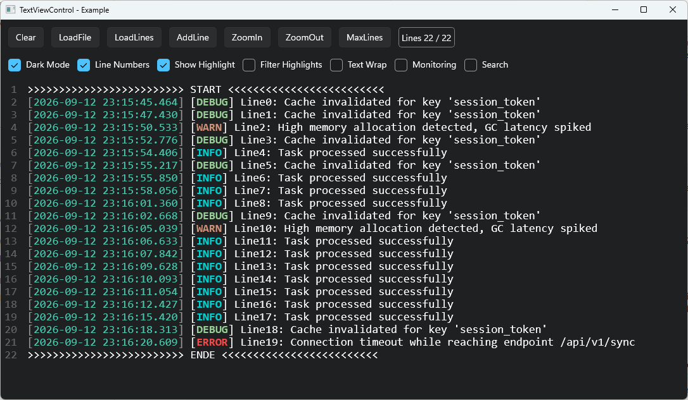
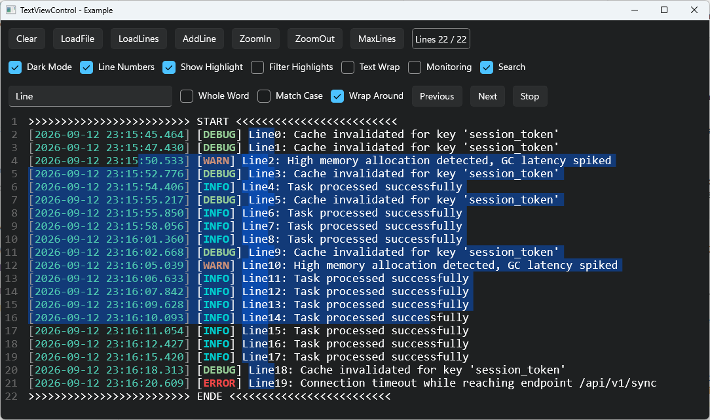
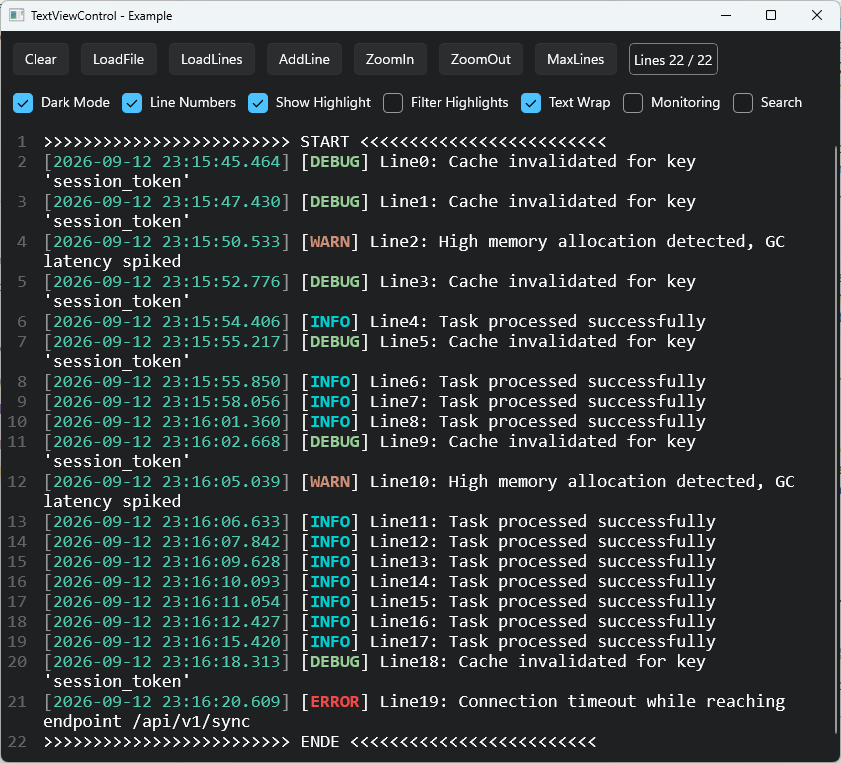
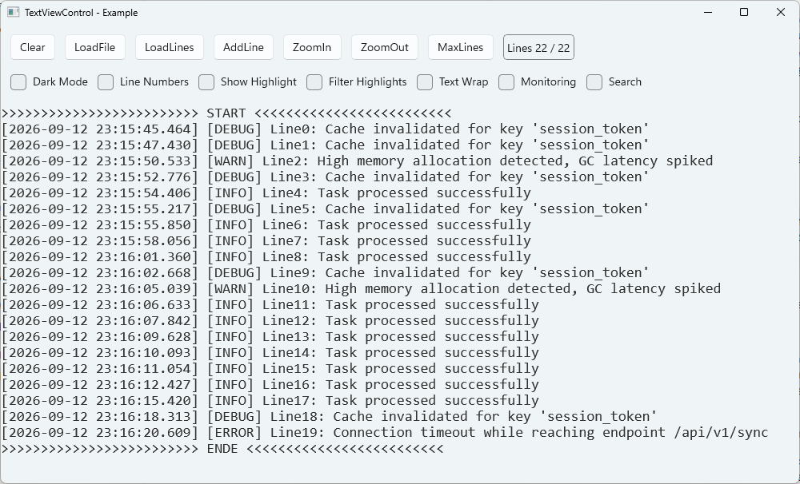

# TextViewControl

A fast, read-only text viewer control for **WinUI 3**, drawn with **Win2D**, built for very large log files (millions of lines, 1 GB and more).



Available as NuGet package: [TextViewControl](https://www.nuget.org/packages/TextViewControl)

```
dotnet add package TextViewControl
```

## Features

- Millions of lines: loading 1 GB / 14 million lines takes a few seconds, scrolling and zooming stay instant
- Word wrap: only the visible lines are measured
- Syntax highlighting with regular expressions (color, bold, italic, underline), separate colors for light and dark theme
- Color filter: show only the lines that match a highlight rule
- Live data: `AddLine`/`AddLines`, `MaxLines` + `Monitoring` (show the newest lines), scrollback buffer (`MaxTotalLines`)
- Search with match count, next/previous, whole word, match case
- Selection with mouse and keyboard, copy, context menu, line numbers
- **Native AOT compatible**: the library is marked `IsAotCompatible` (no trim or AOT warnings), the sample app is published with Native AOT

Usage and code examples: see the [package README](TextViewControl/README.md).

## Screenshots

| Search and selection over several lines | Text wrap |
|---|---|
|  |  |

| Light theme without line numbers and highlighting |
|---|
|  |

## Repository

| Folder | Content |
|---|---|
| [`TextViewControl/`](TextViewControl/) | The control as class library, this is the NuGet package |
| [`TextViewControlApp/`](TextViewControlApp/) | Sample app to try the control |
| `TextViewControl.slnx` | Solution with both projects |

## Building

Requirements: Windows 10 1809 or later, .NET 10 SDK, Visual Studio 2026 or later with the workload *WinUI application development*. The library targets .NET 8 (usable in apps with .NET 8 or later), the sample app .NET 10.

```
dotnet build TextViewControl.slnx -c Release
```

Publish the sample app with Native AOT (native exe, no .NET runtime needed, fast start). Requires the Visual Studio workload *Desktop development with C++* (linker) and runs best in the *Developer PowerShell for VS*:

```
dotnet publish TextViewControlApp/TextViewControlApp.csproj -c Release -p:PublishProfile=win-x64
```

The result is in `TextViewControlApp/bin/Release/net10.0-windows10.0.19041.0/win-x64/publish/`.

Or simply double-click one of the scripts:

| Script | Does |
|---|---|
| `BuildAot.cmd` | Publishes the sample app with Native AOT to `publish\win-x64\` (`BuildAot.cmd x86` or `BuildAot.cmd arm64` for the other platforms) |
| `CleanBuild.cmd` | Deletes `bin`, `obj`, `publish`, `nupkg` and `.vs` (close Visual Studio first) |

Create the NuGet package:

```
dotnet pack TextViewControl/TextViewControl.csproj -c Release -o nupkg
```

## Sample app

Open `TextViewControl.slnx` in Visual Studio, set `TextViewControlApp` as startup project and start it (profile *TextViewControlApp (Unpackaged)*). After building, the app can also be started directly with `TextViewControlApp.exe` in the output folder.

The app shows generated log lines and has buttons and check boxes for the main features: load a file or many lines, add lines, zoom, `MaxLines`, dark mode, line numbers, highlighting, color filter, word wrap, monitoring and a search bar (next, previous, whole word, match case, wrap around).

## Credits

Based on ideas from [TextControlBox-WinUI](https://github.com/FrozenAssassine/TextControlBox-WinUI) and [Win2D_TextRendering](https://github.com/FrozenAssassine/Win2D_TextRendering) by FrozenAssassine.

## License

[MIT](LICENSE)
